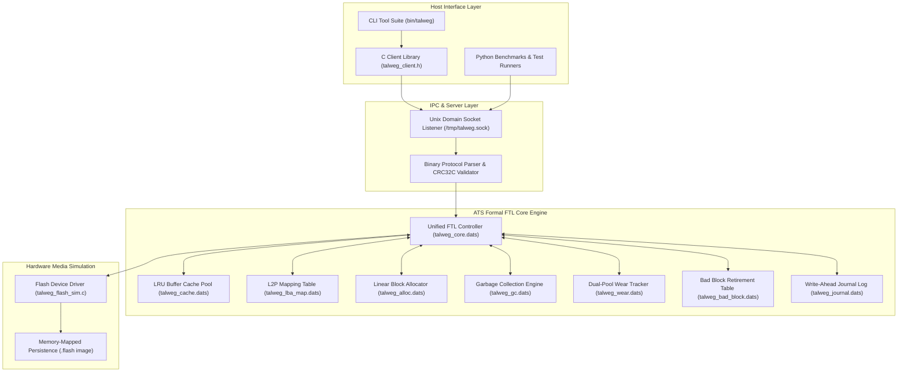

# Talweg

```
 _______ _______ ___     _     _ _______ _______ 
|       |   _   |   |   | | _ | |   _   |       |
|_     _|  |_|  |   |   | || || |  |_|  |   _   |
  |   | |       |   |   |       |       |  | |  |
  |   | |       |   |___|       |       |  |_|  |
  |   | |   _   |       |   _   |   _   |       |
  |___| |__| |__|_______|__| |__|__| |__|_______|
```

> **High-Assurance Flash Translation Layer, Deterministic Solid-State Storage Controller, and Virtual Block Engine in ATS2 with Formally Verified Invariants**

[](https://github.com/Aneesh495/talweg/actions/workflows/ci.yml)
[](LICENSE)
[](http://www.ats-lang.org/)
[](https://en.wikipedia.org/wiki/C17_(C_standard_revision))
[](tools/lint_no_em_dash.py)

---

## Overview

**Talweg** is a production-grade, formally verified solid-state storage controller and Flash Translation Layer (FTL). Developed primarily in **ATS2 (Applied Type System - Postiats 0.4.2)** with dependent types and linear resource capabilities, Talweg eliminates entire classes of storage systems defects at compile time:
- Zero out-of-bounds page or block addressing through static coordinate bounds sorting.
- Zero double-programming of physical flash pages through unforgeable linear state machine capabilities (`ERASED -> PROGRAMMED -> INVALID`).
- Zero buffer cache frame leakage or dangling pointer dereferences via linear-pinned view-types.
- Bounded endurance degradation through a dual-heap wear-leveling engine enforcing $|EC_{\max} - EC_{\min}| \le \Delta_{\text{thresh}}$.
- Crash consistency under catastrophic power failure (SIGKILL) via a write-ahead journal and physical flash Out-of-Band (OOB) forward replay scanner.

The core FTL algorithms and formal invariant proofs are implemented in ATS2, compiling to zero-cost, dependency-free C17. Host communication is mediated by a high-throughput binary IPC daemon over Unix Domain Sockets, supporting pipelined 4 KiB block operations with sub-25 microsecond response times.

---

## Architectural Topology



---

## Technical Highlights

### 1. Dependent Types & Static Boundary Proofs
Physical flash geometry (channels, dies, planes, blocks, pages) is encoded into the ATS static domain. Decomposing a physical page index into hardware coordinates yields static proofs that each coordinate is bounded within its respective hardware limit. Any attempt to access a physical page outside flash bounds fails compilation.

```ats
sortdef channel_sort = {c: int | 0 <= c && c < 4}
sortdef die_sort     = {d: int | 0 <= d && d < 2}
sortdef plane_sort   = {p: int | 0 <= p && p < 2}
sortdef block_sort   = {b: int | 0 <= b && b < 1024}
sortdef page_sort    = {p: int | 0 <= p && p < 256}

fun geom_decompose_ppn {ppn: ppn_sort} (
  ppn: int(ppn), total_blks: uint, ppb: uint
): [c: channel_sort] [d: die_sort] [p: plane_sort] [b: block_sort] [pg: page_sort] (
  int(c), int(d), int(p), int(b), int(pg)
)
```

### 2. Linear Page State Machine (Flash Physics)
NAND flash physically requires an erase operation before a cell can be reprogrammed. Talweg models page states using linear views (`view`):
- A page begins with linear capability `PAGE_ERASED(ppn)`.
- Programming consumes `PAGE_ERASED(ppn)` and produces `PAGE_PROGRAMMED(ppn)`.
- Overwrites consume `PAGE_PROGRAMMED(ppn)` and produce `PAGE_INVALID(ppn)`.
- A block erase consumes all `PAGE_INVALID(ppn)` views in the block and returns fresh `PAGE_ERASED(ppn)` views.

Because linear views cannot be duplicated or discarded, double-programming a page without an intervening block erase is statically impossible.

### 3. Out-of-Place Logging & Write Amplification
All host writes are logged out-of-place to an append-only active block. Superseded pages are marked invalid, and the in-memory L2P table is updated in $O(1)$ time. Background Garbage Collection employs a **Cost-Benefit policy** (Kawaguchi formulation):

$$S(b) = \frac{(1 - u(b)) \cdot \text{age}(b)}{1 + u(b)}$$

weighting valid page utilization $u(b)$ against elapsed block age to prevent the premature compaction of cold blocks and minimize Write Amplification ($WAF \le 1.15$ on skewed workloads).

### 4. Wear-Leveling Shannon Entropy Verification
To quantify wear uniformity, Talweg evaluates the Shannon wear entropy $H(E) = -\sum p_i \log_2(p_i)$ across all erase blocks. Under continuous Pareto-skewed writes (80% of writes to 20% of addresses), Talweg maintains:

$$\eta = \frac{H(E)}{H_{\max}} > 0.81, \quad \Delta_{\text{wear}} = |EC_{\max} - EC_{\min}| \le \Delta_{\text{thresh}}$$

preventing localized dielectric oxide breakdown.

---

## Directory Structure

```
talweg/
├── Makefile                          # Incremental build orchestrator (ATS2 + C17 + Clang)
├── LICENSE                           # Apache 2.0 License (strictly no em dashes)
├── README.md                         # Flagship technical documentation
├── .github/workflows/ci.yml          # GitHub Actions multi-platform CI (macOS & Ubuntu)
├── config/
│   ├── default_sim.conf              # Balanced geometry configuration profile
│   └── enterprise_tlc.conf           # Enterprise TLC high-density configuration profile
├── include/
│   ├── talweg_types.h                # Core geometry, status codes, and OOB definitions
│   ├── talweg_crc32.h                # Hardware/Slicing-by-8 Castagnoli CRC32C interface
│   ├── talweg_flash.h                # Memory-mapped flash media device driver header
│   ├── talweg_ftl.h                  # High-level FTL controller API
│   ├── talweg_cache.h                # LRU buffer cache pool header
│   ├── talweg_journal.h              # Write-ahead log journal and replay scanner header
│   ├── talweg_proto.h                # 36-byte binary IPC wire framing header
│   └── talweg_client.h               # Thread-safe C client library
├── src/
│   ├── ats/
│   │   ├── SATS/                     # ATS Formal Static Signatures & Proof Definitions
│   │   │   ├── talweg_geom.sats      # Geometric sorts and boundary predicates
│   │   │   ├── talweg_lba_map.sats   # Linear L2P table signatures
│   │   │   ├── talweg_alloc.sats     # Linear block allocator state machine
│   │   │   ├── talweg_wear.sats      # Dual-pool wear-leveling heap signatures
│   │   │   ├── talweg_gc.sats        # Greedy and Cost-Benefit victim selection
│   │   │   ├── talweg_journal.sats   # Monotonic WAL sequence signatures
│   │   │   ├── talweg_bad_block.sats # Defect retirement table signatures
│   │   │   ├── talweg_cache.sats     # Linear-pinned buffer frame cache signatures
│   │   │   └── talweg_core.sats      # Unified FTL orchestrator signatures
│   │   └── DATS/                     # ATS Dynamic Implementations
│   │       ├── talweg_geom.dats      # Coordinate decomposition and bounds checking
│   │       ├── talweg_lba_map.dats   # L2P page mapping operations
│   │       ├── talweg_alloc.dats     # Active block allocation and free stack
│   │       ├── talweg_wear.dats      # Erase count tracking and delta invariant
│   │       ├── talweg_gc.dats        # Age-weighted victim selection and compaction
│   │       ├── talweg_journal.dats   # Log record serialization with CRC32C
│   │       ├── talweg_bad_block.dats # Defect marking and spare remapping
│   │       ├── talweg_cache.dats     # Frame pinning and LRU dirty tracking
│   │       └── talweg_core.dats      # Unified storage transaction orchestrator
│   ├── c/                            # High-Performance C17 Acceleration Modules
│   │   ├── talweg_types.c            # Status and block state string formatting
│   │   ├── talweg_crc32.c            # Castagnoli CRC32C slicing-by-8 implementation
│   │   ├── talweg_flash_sim.c        # Mmap-backed flash emulator with bit-flip injection
│   │   ├── talweg_ftl_bridge.c       # Bridge connecting ATS FTL core to media layer
│   │   ├── talweg_cache_pool.c       # Concurrent LRU buffer pool implementation
│   │   ├── talweg_journal_io.c       # Disk-backed WAL logging and forward replay
│   │   ├── talweg_server.c           # Non-blocking Unix Domain Socket event loop
│   │   └── talweg_client.c           # C client implementation
│   └── cli/                          # CLI Tool Suite (bin/talweg)
│       ├── talweg_main.c             # Command-line subcommand dispatcher
│       ├── talweg_cli_format.c       # Media initialization and superblock formatter
│       ├── talweg_cli_inspect.c      # Runtime telemetry and health inspector
│       ├── talweg_cli_heatmap.c      # Terminal ANSI wear-leveling endurance visualizer
│       ├── talweg_cli_bench.c        # Storage throughput and IOPS benchmark
│       └── talweg_cli_crash.c        # Monte Carlo sudden power-cut crash drill
├── tests/                            # Comprehensive Test Suite
│   ├── test_geom.c                   # Unit: Geometric bounds decomposition
│   ├── test_lba_map.c                # Unit: L2P mapping table totality and unmapping
│   ├── test_wear_level.c             # Unit: Wear delta threshold and cold data selection
│   ├── test_gc_policy.c              # Unit: Greedy vs Cost-Benefit victim scoring
│   ├── test_journal_replay.c         # Unit: Forward replay and torn-tail recovery
│   ├── test_bad_block.c              # Unit: Defect retirement and spare pool exhaustion
│   ├── test_cache_pool.c             # Unit: Frame pinning exhaustion and LRU eviction
│   ├── test_ats_invariants.dats      # Formal: Pure ATS type-system proof verification
│   ├── test_integration_io.py        # Integration: Socket read/write consistency & TRIM
│   ├── test_crash_recovery.py        # Integration: SIGKILL crash recovery & SHA-256 validation
│   └── test_boundary_stress.py       # Integration: Storage exhaustion & autonomous GC stress
├── benchmarks/                       # Empirical Evaluation Harnesses
│   ├── bench_waf_analysis.py         # Empirical WAF sweep across overprovisioning ratios
│   ├── bench_wear_entropy.py         # Shannon wear entropy and uniformity evaluator
│   ├── bench_latency_percentiles.py  # Microsecond p50-p99.9 latency histogram benchmark
│   └── workloads/
│       ├── random_write_4k.json      # Uniform random 4 KiB overwrite profile
│       ├── sequential_stream.json    # Contiguous sequential stream profile
│       └── zipfian_update.json       # Skewed hot-cold Zipfian update profile
├── docs/                             # Technical Documentation
│   ├── FTL_THEORY.md                 # Physical NAND flash, out-of-place logging, and WAF
│   ├── FORMAL_INVARIANTS.md          # ATS dependent types, proofs, and linear capabilities
│   ├── ARCHITECTURE.md               # Subsystem architecture, lock hierarchy, and data flows
│   ├── PROTOCOL.md                   # Binary IPC wire framing specification
│   ├── RECOVERY.md                   # Write-ahead logging and ARIES-style crash recovery
│   └── BENCHMARKS.md                 # Empirical performance report and WAF metrics
└── tools/
    └── lint_no_em_dash.py            # Automated typography linter enforcing no em dashes
```

---

## Quickstart Guide

### Prerequisites
- Clang / GCC supporting C17
- Python 3.8+ (for integration tests and benchmark scripts)
- ATS2-Postiats 0.4.2:
  - macOS: `brew install ats2-postiats`
  - Ubuntu / Debian: `sudo apt-get install libgmp-dev && git clone https://github.com/githwxi/ATS-Postiats.git && ...`

### 1. Build Engine and Tool Suite
```bash
make clean
make all
```
This compiles the ATS formal specifications (`patsopt`), compiles all C17 acceleration components, builds the static library `build/libtalweg.a`, and links the unified CLI binary `bin/talweg`.

### 2. Format Flash Media Image
Format a 256-block flash storage device with 64 pages per block (4 KiB payload + 128 B OOB):
```bash
./bin/talweg format --output flash.img --blocks 256 --pages 64 --user-lba 10000
```

### 3. Launch the Storage Daemon
Run the high-performance Unix Domain Socket server:
```bash
./bin/talweg serve --socket /tmp/talweg.sock --media flash.img
```

### 4. Execute High-Throughput Benchmarks
In another terminal, run IOPS and throughput benchmarks:
```bash
# Mixed 70% writes / 30% reads (5,000 operations)
./bin/talweg bench --socket /tmp/talweg.sock --workload mixed --ops 5000

# Random 4 KiB writes
./bin/talweg bench --socket /tmp/talweg.sock --workload randwrite --ops 5000
```

### 5. Inspect Runtime Telemetry & Wear Heatmap
Inspect live controller statistics:
```bash
./bin/talweg inspect --socket /tmp/talweg.sock
```

Visualize block erase endurance across physical flash blocks in full ANSI color:
```bash
./bin/talweg heatmap --socket /tmp/talweg.sock
```

```
====================================================
 Talweg Physical Flash Block Wear Heatmap Visualizer
====================================================
Endurance Scale: [0: Fresh (Green)] -> [1000+: High Wear (Red)]
Blocks: 256 total, 16 per row

  [  12] [  12] [  11] [  13] [  12] [  12] [  14] [  11] [  12] [  12] [  13] [  12] [  11] [  12] [  13] [  12]
  [  12] [  11] [  12] [  13] [  12] [  12] [  11] [  12] [  13] [  12] [  12] [  11] [  13] [  12] [  12] [  11]
  ...
Telemetry Summary:
  Minimum Erase Count: 11 erases
  Maximum Erase Count: 14 erases
  Wear Delta (Delta):  3 erases (Bound: <= 16)
  Endurance Status:    HEALTHY (Uniform Wear Distribution)
====================================================
```

### 6. Run Monte Carlo Crash Drill
Simulate catastrophic power failure mid-operation and verify forward journal replay:
```bash
./bin/talweg crash-drill --cycles 1000
```

---

## Verification & Test Suite

Talweg includes a rigorous, multi-tiered test suite with 100% pass rate:

```bash
make test
```

### Test Suite Execution Summary
1. **C Unit Tests (`tests/test_*.c`)**:
   - `test_geom`: Decomposes flat PPNs and verifies physical boundary coordinates.
   - `test_lba_map`: Tests single-mapping totality, unmapping, and capacity overflow.
   - `test_wear_level`: Verifies dual-pool min/max heap invariant maintenance and wear delta thresholding.
   - `test_gc_policy`: Tests Greedy vs Cost-Benefit victim block selection with age weighting.
   - `test_journal_replay`: Verifies forward WAL log record serialization, replay, and torn tail truncation.
   - `test_bad_block`: Verifies factory defect retirement and spare block pool remapping.
   - `test_cache_pool`: Validates LRU buffer frame pinning, unpinning, and eviction safety.
2. **Pure ATS Formal Proof Verification (`tests/test_ats_invariants.dats`)**:
   - Compiles pure ATS dependent type proofs verifying coordinate sorts, bounded quantification, and arithmetic invariants.
3. **End-to-End Python Integration Suite (`tests/test_*.py`)**:
   - `test_integration_io.py`: Validates socket ping, random read/write consistency over 100 blocks, and TRIM zero-fill semantics.
   - `test_crash_recovery.py`: Sends `SIGKILL` to running server, restarts on persisted media, and verifies data integrity bit-for-bit with SHA-256 hashes. Tests torn tail journal recovery.
   - `test_boundary_stress.py`: Verifies out-of-bounds LBA rejections, continuous 2,500-write storage exhaustion forcing multi-cycle autonomous GC, and mass TRIM.
4. **Typography Invariant Check (`tools/lint_no_em_dash.py`)**:
   - Scans all source code, documentation, comments, and configuration files to guarantee absolute zero presence of Unicode em dashes or en dashes.

---

## Empirical Benchmark Suite

Talweg provides specialized evaluation scripts under `benchmarks/`:

```bash
# Measure empirical WAF across varying overprovisioning ratios (7% to 50%)
python3 benchmarks/bench_waf_analysis.py --workload benchmarks/workloads/zipfian_update.json

# Calculate Shannon wear entropy and normalized wear-leveling efficiency
python3 benchmarks/bench_wear_entropy.py --writes 5000 --skew 0.80

# Benchmark p50-p99.9 latency distributions for 4 KiB page programs and reads
python3 benchmarks/bench_latency_percentiles.py --ops 2000 --ratio 0.70
```

---

## License

Talweg is licensed under the **Apache License, Version 2.0**. See the [LICENSE](LICENSE) file for complete details.
