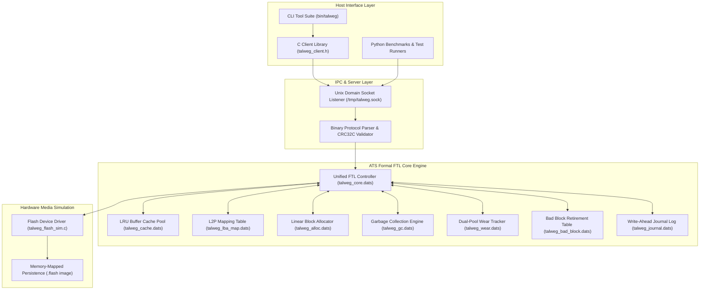

# Talweg Storage Controller Subsystem Architecture

## 1. System Overview

Talweg is structured as a modular, high-assurance solid-state storage controller. The architecture decouples the host protocol interface from the underlying media persistence layer through a core engine orchestrated in ATS2 with dependent type proofs, complemented by high-performance C17 acceleration modules.



---

## 2. Subsystem Descriptions

### 2.1 Host Interface & Binary IPC Engine
- **`talweg_server.c`**: Implements a non-blocking Unix Domain Socket event loop utilizing POSIX `select()` with 100ms polling timeouts for sub-second graceful teardown. Handles binary frame deserialization, packet header validation, command execution, and telemetry emission.
- **`talweg_client.c`**: Thread-safe client library implementing pipelined read, write, trim, flush, stats, and garbage collection requests over local domain sockets.
- **Wire Framing**: 36-byte fixed-size binary frame (`talweg_proto_hdr_t`) verified via Castagnoli CRC32C checksums over both packet headers and data payloads.

### 2.2 Formal FTL Core Orchestrator
- **`talweg_core.dats` / `talweg_core.sats`**: Unified transaction manager responsible for coordinating page allocations, mapping updates, dirty cache writebacks, journal appends, and garbage collection passes.
- **`talweg_lba_map.dats`**: Direct-mapped page table indexing logical block addresses ($LBA$) to physical page numbers ($PPN$). Enforces single-mapping totality and reverse OOB consistency.
- **`talweg_alloc.dats`**: Manages active block allocation, page pointer advances, open block lifecycle transitions, and free block reclamation.
- **`talweg_wear.dats`**: Dual-heap wear-leveling engine tracking minimum and maximum block erase counts to guarantee $|EC_{\max} - EC_{\min}| \le \Delta_{\text{thresh}}$.
- **`talweg_gc.dats`**: Implements both Greedy and Cost-Benefit victim selection policies. Manages valid page copy-forward routines and block erase reclamation.
- **`talweg_bad_block.dats`**: Factory and runtime defect retirement table with remapping from an overprovisioned spare block pool.
- **`talweg_cache.dats` / `talweg_cache_pool.c`**: Buffer cache pool managing pinned frames with linear capabilities to prevent memory leaks and use-after-free bugs.

### 2.3 Physical Flash Simulation Layer
- **`talweg_flash_sim.c`**: High-fidelity NAND flash emulator backed by memory-mapped files (`mmap`). Emulates erase-before-write constraints, out-of-band spare area layout, hardware-enforced sequential page programming within open blocks, and synthetic bit-flip injection for fault-tolerance testing.

---

## 3. Data Flow Pipelines

### 3.1 Write Transaction Pipeline (Out-of-Place Update)

```
Host Write Request (LBA, 4KiB Payload)
       |
       v
1. Check Buffer Cache Pool
       |-- If already present in cache: pin frame, copy payload, mark DIRTY.
       +-- If cache miss: proceed to direct flash pipeline.
       |
       v
2. Allocate New Physical Page (PPN)
       |-- Request next page from Active Open Block in Allocator.
       +-- If active block full: close block, pop fresh block from Free Stack.
       +-- If Free Stack depleted: trigger emergency GC compaction step.
       |
       v
3. Append to Write-Ahead Journal (WAL)
       |-- Append WAL_REC_WRITE record with LBA, PPN, transaction seq, and CRC32C.
       |
       v
4. Program Physical Flash Page & OOB Header
       |-- Verify destination page is in ERASED (0xFF) state.
       |-- Compute data CRC32C over 4096-byte payload.
       |-- Populate OOB: {lba, seq, flags, crc_data, crc_header}.
       |-- Commit to memory-mapped flash media via memcpy.
       |
       v
5. Update L2P Mapping Table
       |-- Previous PPN for this LBA is retrieved and marked INVALID.
       |-- L2P[LBA] is updated to point to new PPN.
       |
       v
6. Return Status OK to Host
```

### 3.2 Read Transaction Pipeline

```
Host Read Request (LBA)
       |
       v
1. Verify LBA Bounds (LBA < max_lba)
       |-- If out of bounds: return TALWEG_ERR_OUT_OF_BOUNDS.
       |
       v
2. Query L2P Table
       |-- If L2P[LBA] == TALWEG_UNMAPPED_PPN:
       |     Directly zero-fill caller output buffer and return TALWEG_OK.
       |
       v
3. Query Cache Pool
       |-- If cached: pin frame, copy 4KiB data to out_buf, unpin, return TALWEG_OK.
       |
       v
4. Physical Flash Read
       |-- Compute byte offset: PPN * (page_size + oob_size).
       |-- Copy 4096 bytes from flash media to caller buffer.
       |-- Read OOB spare metadata.
       |-- Verify data CRC32C matches oob.crc_data (detect silent bit rot).
       |-- Return TALWEG_OK.
```

---

## 4. Concurrency Model and Lock Hierarchy

To prevent deadlocks while enabling concurrent client connections, Talweg establishes a strict hierarchical lock order:

```
Tier 1: Server Connection Lock (Socket Accept & Client Registry)
          |
          v
Tier 2: Page Buffer Cache Pool Lock (LRU Queue & Frame Hash)
          |
          v
Tier 3: FTL Controller Transaction Lock (L2P & Allocator State)
          |
          v
Tier 4: Write-Ahead Journal Log Lock (File Append & Replay Pointer)
          |
          v
Tier 5: Flash Media Driver Lock (mmap msync & Hardware Register)
```

Locks must always be acquired in descending tier order (Tier 1 -> Tier 2 -> Tier 3 -> Tier 4 -> Tier 5) and released in reverse order. No function holding a lower-tier lock may attempt to acquire a higher-tier lock.
